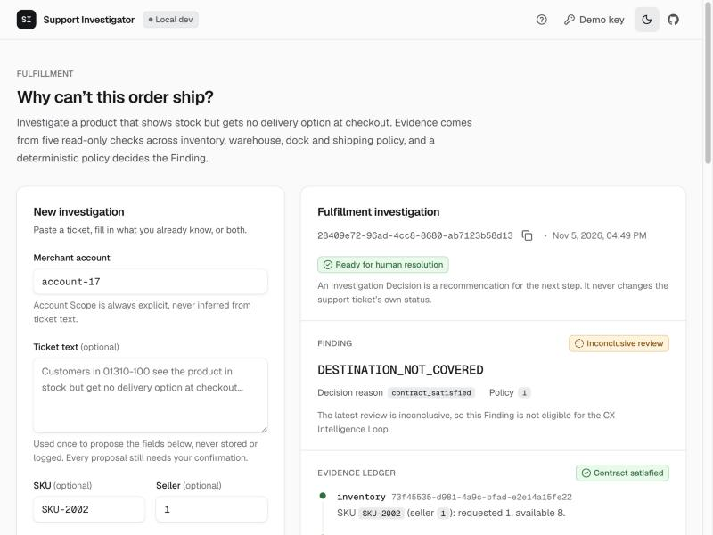
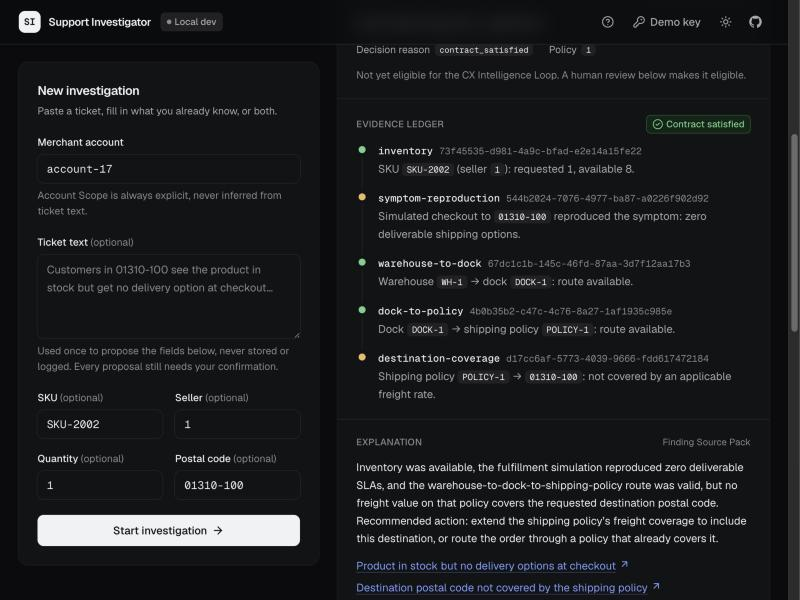
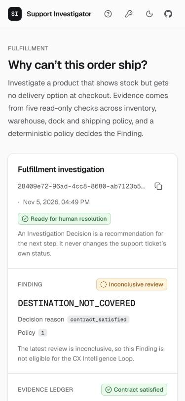
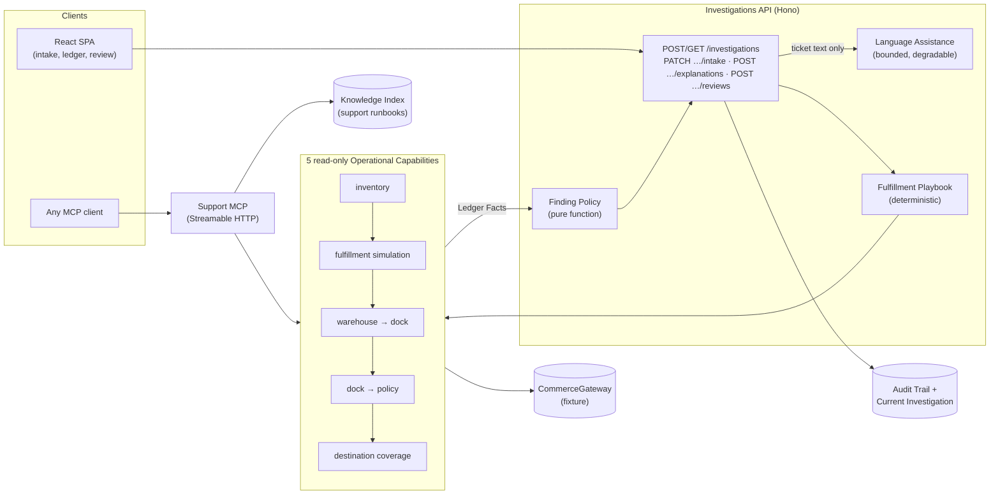

# Support Investigator

[](https://github.com/rafactx/support-investigator/actions/workflows/ci.yml)
[](./LICENSE)

**A read-only investigator for commerce fulfillment tickets in which a deterministic policy, not a language model, makes the decision.**

**Live demo:** [support-investigator.rafactx.workers.dev](https://support-investigator.rafactx.workers.dev). One Cloudflare Worker serves the app, the API and the MCP server, with D1 and Workers AI. Paste a ticket, confirm what the model proposed, and watch the policy decide.

<p align="center">
  
</p>

## Why

LLMs are good at reading messy support tickets and bad at being accountable for a decision. This project asks one question: **how far can a deterministic policy keep an LLM out of a support decision's critical path, and still be useful?**

The answer here is a narrow, auditable pipeline for one recurring symptom, *"the product shows stock, but checkout offers no delivery option"* (`STOCK_WITHOUT_DELIVERY_OPTIONS`):

1. **Intake.** A support engineer (N2) gives structured fields, ticket text, or both. A model may *propose* fields from the text. Every proposal stays unconfirmed until a human confirms it.
2. **Evidence.** A deterministic Fulfillment Playbook runs five read-only Operational Capabilities: inventory, fulfillment simulation, warehouse → dock, dock → shipping policy, and destination coverage. Each capability turns a raw provider payload into one typed, versioned **Ledger Fact** tied to the call that produced it. The raw payload is never stored.
3. **Decision.** A pure **Finding Policy** evaluates an Evidence Contract over the ledger. It assigns `DESTINATION_NOT_COVERED` only when the contract is satisfied, and `ROOT_CAUSE_UNDETERMINED` when evidence is insufficient or contradictory. It then returns an Investigation Decision: `ready_for_human_resolution`, `needs_input` or `requires_specialist_review`. It never claims that a ticket was closed.
4. **Review.** N2 confirms, corrects, or marks the Finding inconclusive. Reviews are appended to an immutable audit trail.

<p align="center">
  
  
</p>

## Architecture



- **Support MCP** exposes the same five capabilities, plus documentary search over the knowledge index, to any MCP client: `observe_inventory`, `observe_fulfillment_simulation`, `observe_warehouse_to_dock`, `observe_dock_to_policy`, `observe_destination_coverage` and `search_support_knowledge`. It is an adapter. The first-party API never calls its own MCP endpoint ([ADR-0039](./docs/adr/0039-fulfillment-playbook-is-deterministic-and-mcp-is-an-adapter.md)).
- **CommerceGateway** is fixture-only. It serves self-designed, provider-shaped payloads for the Public Reference Scenarios, so everything runs with no credentials ([ADR-0005](./docs/adr/0005-fixture-first-commerce-gateway.md)). A live adapter only has to pass the shared contract suite ([ADR-0012](./docs/adr/0012-gateway-contract-suite-is-parameterized-by-target.md)).
- **Persistence** is an append-only audit trail plus a projection of the current investigation ([ADR-0034](./docs/adr/0034-audit-trail-is-append-only-with-a-current-investigation-projection.md)). There are three adapters, in-memory, Cloudflare D1 and DynamoDB, and all pass one shared contract suite.

## What the LLM may and may not do

| The model **may** | The model **may not** |
| --- | --- |
| Propose `skuId`, `seller`, `quantity` and `destinationPostalCode` from ticket text. Each proposal stays `confirmed: false` until N2 confirms it. | Propose Account Scope. The extraction schema has no key for it. |
| Rewrite a deterministic explanation when N2 explicitly asks. It may only use `{{placeholder}}` tokens and cite URLs from the Finding Source Pack. | Choose or sequence a capability, create a Ledger Fact, or assign a Finding Code or Decision. |
| Fail. Every model call has a timeout and an output-token ceiling. A failure is reported as `unavailable`, and the deterministic path continues. | Have raw ticket text stored or logged. Idempotency uses a digest of the text ([ADR-0043](./docs/adr/0043-ticket-text-idempotency-uses-a-digest-never-the-raw-text.md)). |

A rewritten explanation is accepted only if a structural grounding check passes: no literal identifiers, only allowed placeholders, and only Source Pack citations. Otherwise the rewrite is rejected and the deterministic text stays ([ADR-0045](./docs/adr/0045-explanation-improvement-grounding-is-structural-not-semantic.md)).

## Evals and safety

Every number below comes from running the commands in this repository.

| Command | What it is | Gates CI |
| --- | --- | --- |
| `pnpm test` | 446 Vitest tests in 47 files, 41 of them inside the Workers runtime against a local D1 (27 more are skipped because they need live DynamoDB credentials). They cover the Public Reference Scenarios end to end, the Finding Policy truth table, capability failure classification (permission, transport, schema), the repository and gateway contract suites, MCP adapter contracts, abuse controls, the Cloudflare Worker composition, and the CDK stack. | Yes |
| Ticket-injection sabotage battery (inside `pnpm test`) | Adversarial ticket text tries to supply Account Scope, pre-confirm fields, inject a Ledger Fact and dictate a Finding. A worst-case compromised extractor echoes all of it. The battery proves none of it takes effect, and a deliberately broken twin proves the battery really fails when the boundary breaks. | Yes |
| `pnpm evals:intake` | 30 labeled PT/EN tickets run through the intake pipeline with **scripted** extractor outputs, including deliberate fabrications and decoys. It checks per-field precision and recall, the invented-identifier rate, and that every proposal stays unconfirmed. This tests the harness and the boundary. It does **not** measure model quality. | Yes |
| `pnpm evals:intake:live` | The same 30 tickets against a real model: `LANGUAGE_MODEL_PROVIDER=workers-ai` with Cloudflare credentials, or Bedrock by default. It is informational and never gates. If credentials are unavailable, it reports `SKIPPED` instead of passing. No live results are published here. | No |

An earlier version of this project had a model-driven `/investigate` route and a 15-ticket golden-ticket eval harness. Both were removed when the deterministic playbook replaced the agent loop ([ADR-0046](./docs/adr/0046-cut-over-to-resource-oriented-investigation-and-remove-strands.md)). Determinism is now proven by ordinary tests, not by a scripted model run.

**Abuse controls** for a public deployment are platform-neutral Hono middleware ([ADR-0047](./docs/adr/0047-public-demo-abuse-controls-are-platform-neutral-middleware.md)). It caps the request body size and ticket text (4,000 characters). It applies fixed-window rate limits keyed by a salted digest of the client address: investigation creation, model-assisted requests per client, a global model budget, writes and MCP calls. A valid demo key bypasses the limits. Every denial returns a generic `429` and is logged server-side.

## Quickstart

Requires Node.js 22+ and pnpm.

```bash
pnpm install && pnpm dev
```

`pnpm dev` alone prints usage. No credentials are needed: the capabilities run against the fixture gateway, and Language Assistance defaults to `fake`, which proposes nothing and makes no network calls.

```bash
pnpm dev serve                                      # Investigations API on :8787
pnpm dev inventory SKU-2002 1 1                     # one capability, through the Support MCP
pnpm dev simulate-fulfillment SKU-2002 1 1 01310-100
pnpm dev search-knowledge "no delivery option"
```

```bash
curl -s -X POST http://localhost:8787/investigations \
  -H "Content-Type: application/json" -H "Idempotency-Key: demo-1" \
  -d '{"symptomCode":"STOCK_WITHOUT_DELIVERY_OPTIONS","accountScope":{"accountId":"account-17"},
       "skuId":"SKU-2002","seller":"1","quantity":1,"destinationPostalCode":"01310-100"}'
# → finding DESTINATION_NOT_COVERED, contract satisfied, ready_for_human_resolution
```

Frontend: run `cd web && pnpm dev`. Vite proxies `/investigations` to `:8787`.

To let a real model propose intake fields, start the API with `LANGUAGE_MODEL_PROVIDER=workers-ai pnpm dev serve` (with `CLOUDFLARE_ACCOUNT_ID` and a `CLOUDFLARE_API_TOKEN` that can run Workers AI) or `LANGUAGE_MODEL_PROVIDER=bedrock pnpm dev serve` (with AWS credentials that can call Bedrock).

To run the Cloudflare Worker itself, with the SPA, a local D1 and the rate limiters: `cp .dev.vars.example .dev.vars && pnpm cf:dev`. [`docs/demo-script.md`](./docs/demo-script.md) walks through three scripted cases: the satisfied contract, the Language Assistance boundary, and CI going red on purpose.

### Configuration

| Variable | Values | Default |
| --- | --- | --- |
| `LANGUAGE_MODEL_PROVIDER` | `workers-ai`, `bedrock`, `fake` | `fake` locally, `workers-ai` on the Cloudflare Worker, `bedrock` on the AWS Lambda |
| `WORKERS_AI_MODEL` | Workers AI text model id | `@cf/meta/llama-3.3-70b-instruct-fp8-fast` |
| `CLOUDFLARE_ACCOUNT_ID`, `CLOUDFLARE_API_TOKEN` | Workers AI over REST, for Node scripts only | unset; the Worker uses its `AI` binding |
| `MODEL_ID`, `AWS_REGION` | Bedrock inference-profile id, region | Claude Haiku 4.5 profile, `us-east-1` |
| `LANGUAGE_ASSISTANCE_TIMEOUT_MS` | per-call model timeout, at most 20,000 | `4000` |
| `EMBED_PROVIDER` | `lexical`, `workers-ai`, `bedrock-titan`, `local` | `lexical`, a deterministic hashing bag-of-words (lexical overlap, not semantics). This is the committed index. |
| `RATE_LIMIT_*`, `DEMO_KEY`, `RATE_LIMIT_SALT` | see [`.env.example`](./.env.example) and [`wrangler.jsonc`](./wrangler.jsonc) | read by the abuse-control middleware |

## Using the Support MCP

Any Streamable HTTP MCP client can connect to `/mcp`. Locally, `pnpm dev <command>` starts a Support MCP server, connects to it with the official MCP SDK client, and calls the tool directly. That proves the adapter works without a model in the loop. On the Cloudflare Worker, `/mcp` is open and rate-limited per client. On the reference AWS deployment, `/mcp` requires the `x-demo-key` header ([ADR-0019](./docs/adr/0019-mcp-route-gated-behind-demo-key-too.md)).

## Deployment

- **Live demo (Cloudflare):** one Worker serves the Investigations API, the Support MCP and the SPA (Workers Static Assets) on one origin, with D1 as the audit trail and Workers AI as the model ([ADR-0048](./docs/adr/0048-cloudflare-workers-is-the-live-demo-target-with-workers-ai.md)). Per-client burst limits use the Workers Rate Limiting binding; the global daily model budget is a D1 counter sized to stay inside the Workers AI free allocation. `pnpm cf:check` builds the bundle with no login; `pnpm cf:dev` runs it locally with a local D1. [`docs/deploy-cloudflare.md`](./docs/deploy-cloudflare.md) is the deploy runbook.
- **Reference AWS deployment (CDK):** `infra/` defines API Gateway HTTP API → Investigations Lambda (DynamoDB audit trail) and Support MCP Lambda, a demo-key Lambda authorizer, and the SPA on S3 + CloudFront. `pnpm cdk synth` runs in CI with no credentials. The stack is meant to be up only during a demo, and [`docs/runbooks/cdk-destroy.md`](./docs/runbooks/cdk-destroy.md) is a required teardown step. After a deploy, `pnpm smoke:deployed` runs the authenticated release smoke ([`docs/release-evidence.md`](./docs/release-evidence.md)).

## Project status

- **Done:** the focused Fulfillment Investigation end to end: resource-oriented API, durable audit trail, intake confirmation, explanation improvement, Human Review, Support MCP v2, the SPA, CI, the Cloudflare Worker target, and the reference AWS deployment.
- **Platform seams:** `InvestigationRepository`, `RateLimiter`, `LanguageAssistance` (`createModelLanguageAssistance(model)`), `EmbedProvider` and `CommerceGateway`, with Cloudflare and AWS implementations and, where one exists, a shared contract suite.
- **Not done:** the first public deployment of the Cloudflare target, an asynchronous worker, the CX intelligence loop ([ADR-0027](./docs/adr/0027-cx-intelligence-loop-is-the-required-second-slice.md)), and a live commerce-platform adapter.

All fixtures, identifiers and payload shapes are synthetic. This is an independent project.

## Learn more

- [`CONTEXT.md`](./CONTEXT.md): the domain glossary.
- [`docs/adr/`](./docs/adr/): every architecture decision, in order.
- [`docs/demo-script.md`](./docs/demo-script.md): the three-minute scripted demo.

## Contributing

See [CONTRIBUTING.md](./CONTRIBUTING.md) for setup, the checks CI runs and the pull request flow. Report vulnerabilities as described in [SECURITY.md](./SECURITY.md).

## License

[MIT](./LICENSE)
